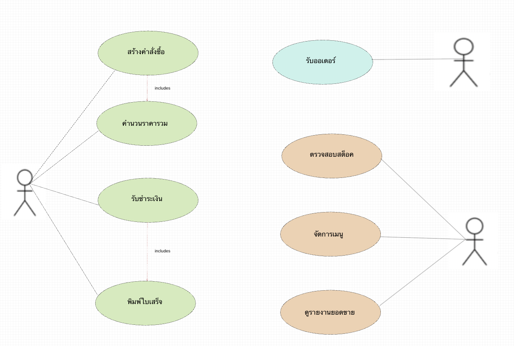

# wk04 - User Stories และ Use Case Diagram

## 1. แปลง Functional Requirement แต่ละข้อเป็น User Story อย่างน้อย 6 เรื่อง ตามรูปแบบ "As a... I want... So that..." พร้อมระบุ Acceptance Criteria อย่างน้อยเรื่องละ 2 ข้อ ในรูปแบบ Given-When-Then

### User Stories

### US-01 สร้างรายการสั่งซื้อ (อ้างอิง FR-01)

**As a** พนักงานหน้าร้าน  
**I want** เลือกเมนู ระบุจำนวน และยืนยันรายการสั่งซื้อ  
**So that** ระบบสามารถบันทึกรายการสั่งซื้อได้อย่างถูกต้องและสร้างหมายเลขคำสั่งซื้อภายใน 2 วินาที

### Acceptance Criteria

**Scenario 1**

- Given พนักงานหน้าร้านเข้าสู่ระบบแล้ว
- When เลือกเมนู ระบุจำนวน และกดยืนยัน
- Then ระบบต้องสร้างรายการสั่งซื้อพร้อมหมายเลขคำสั่งซื้อภายใน 2 วินาที

**Scenario 2**

- Given พนักงานหน้าร้านยังไม่ได้เลือกเมนู
- When กดยืนยันรายการสั่งซื้อ
- Then ระบบต้องแจ้งเตือนว่าไม่สามารถสร้างคำสั่งซื้อได้จนกว่าจะเลือกสินค้า

---

### US-02 คำนวณราคารวม (อ้างอิง FR-02)

**As a** พนักงานหน้าร้าน
**I want** ให้ระบบคำนวณราคารวมอัตโนมัติ
**So that** สามารถคิดเงินได้ถูกต้องและรวดเร็ว

### Acceptance Criteria

**Scenario 1**

- Given มีสินค้าอย่างน้อย 1 รายการในสั่งซื้อ
- When ระบบคำนวณยอดรวม
- Then ผลรวมต้องตรงกับราคาสินค้าทุกรายการ

**Scenario 2**

- Given มีการเพิ่มหรือลดจำนวนสินค้า
- When ระบบคำนวณใหม่
- Then ยอดรวมต้องอัปเดตทันทีโดยไม่มีความคลาดเคลื่อน

---

### US-03 รับชำระเงิน (อ้างอิง FR-03)

**As a** พนักงานหน้าร้าน
**I want** รับชำระเงินจากลูกค้า
**So that** คำสั่งซื้อเสร็จสมบูรณ์

### Acceptance Criteria

**Scenario 1**

- Given มีรายการสั่งซื้อ
- When ลูกค้าชำระเงินสำเร็จ
- Then ระบบเปลี่ยนสถานะเป็น "ชำระเงินแล้ว"

**Scenario 2**

- Given ลูกค้าชำระเงินครบ
- When ยืนยันการชำระเงิน
- Then ระบบบันทึกข้อมูลการชำระเงินภายใน 2 วินาที

---

### US-04 พิมพ์ใบเสร็จ (อ้างอิง FR-04)

**As a** พนักงานหน้าร้าน
**I want** สั่งพิมพ์ใบเสร็จหลังจากลูกค้าชำระเงินสำเร็จ
**So that** ลูกค้าได้รับหลักฐานการชำระเงินที่มีข้อมูลครบถ้วน

### Acceptance Criteria

**Scenario 1**

- Given ลูกค้าชำระเงินสำเร็จ
- When พนักงานหน้าร้านกดพิมพ์ใบเสร็จ
- Then ระบบสร้างใบเสร็จพร้อมข้อมูลครบถ้วน

**Scenario 2**

- Given ระบบสร้างใบเสร็จเรียบร้อยแล้ว
- When พนักงานหน้าร้านกดสั่งพิมพ์
- Then ใบเสร็จต้องพิมพ์ภายใน 10 วินาที

---

### US-05 รับรายการสั่งซื้อ (อ้างอิง FR-05)

**As a** บาริสต้า
**I want** รับรายการสั่งซื้อที่ชำระเงินแล้ว
**So that** สามารถเริ่มเตรียมเครื่องดื่มได้

### Acceptance Criteria

**Scenario 1**

- Given ลูกค้าชำระเงินแล้ว
- When ระบบยืนยันคำสั่งซื้อ
- Then รายการต้องแสดงบนหน้าจอบาริสต้าภายใน 5 วินาที

**Scenario 2**

- Given มีหลายคำสั่งซื้อ
- When ระบบส่งรายการใหม่เข้ามา
- Then ระบบต้องแสดงคำสั่งซื้อที่ชำระเงินแล้วและแยกแต่ละรายการอย่างชัดเจน

---

### US-06 จัดการเมนู (อ้างอิง FR-06)

**As a** ผู้ดูแลระบบ
**I want** เพิ่ม แก้ไข และลบเมนู
**So that** เมนูในระบบเป็นปัจจุบัน

### Acceptance Criteria

**Scenario 1**

- Given ผู้ดูแลเข้าสู่ระบบ
- When เพิ่มหรือแก้ไขเมนู
- Then ระบบบันทึกข้อมูลภายใน 3 วินาที

**Scenario 2**

- Given มีเมนูอยู่ในระบบ
- When ลบเมนู
- Then เมนูต้องไม่ปรากฏในรายการ

---

### US-07 ตัดสต็อกวัตถุดิบ (อ้างอิง FR-07)

**As a** ผู้ดูแลระบบ
**I want** ให้ระบบตัดสต็อกอัตโนมัติ
**So that** จำนวนวัตถุดิบถูกต้อง

### Acceptance Criteria

**Scenario 1**

- Given มีการขายสินค้า
- When การขายเสร็จสิ้น
- Then ระบบต้องลดจำนวนวัตถุดิบตามสูตร

**Scenario 2**

- Given สินค้าถูกขายหลายรายการ
- When ระบบตัดสต็อก
- Then จำนวนคงเหลือต้องถูกต้อง 100%

---

### US-08 ดูรายงานยอดขาย (อ้างอิง FR-08)

**As a** ผู้ดูแลระบบ
**I want** ดูรายงานยอดขาย
**So that** สามารถวิเคราะห์ผลการดำเนินงานได้

### Acceptance Criteria

**Scenario 1**

- Given มีข้อมูลยอดขาย
- When เลือกช่วงเวลาเพื่อดูรายงานยอดขาย
- Then ระบบสร้างรายงานภายใน 5 วินาที

**Scenario 2**

- Given รายงานถูกสร้างแล้ว
- When แสดงผล
- Then ข้อมูลต้องตรงกับรายการขายทั้งหมด

---

## 2. ระบุ Actor ทั้งหมดที่เกี่ยวข้องกับระบบร้านกาแฟตามที่กลุ่มวิเคราะห์เอง (อย่างน้อย 3 actor โดยอ้างอิงจากผู้ใช้งานที่ระบุไว้ใน CASE-STUDY-COFFEE-SHOP-STD.md)

| Actor           | หน้าที่/บทบาทในระบบ                                            |
| --------------- | -------------------------------------------------------------- |
| พนักงานหน้าร้าน | สร้างรายการสั่งซื้อ คำนวณราคา รับชำระเงิน และพิมพ์ใบเสร็จ      |
| ผู้ดูแลระบบ     | จัดการเมนู ตรวจสอบสต็อก และดูรายงานยอดขาย                      |
| บาริสต้า        | รับรายการสั่งซื้อที่ชำระเงินแล้ว และเตรียมเครื่องดื่มตามรายการ |

---

## 3. วาด Use Case Diagram แสดงความสัมพันธ์ระหว่าง Actor กับ Use Case อย่างน้อย 6 use case โดยต้องมีความสัมพันธ์แบบ Include หรือ Extend อย่างน้อย 1 คู่ ด้วย StarUML

---
