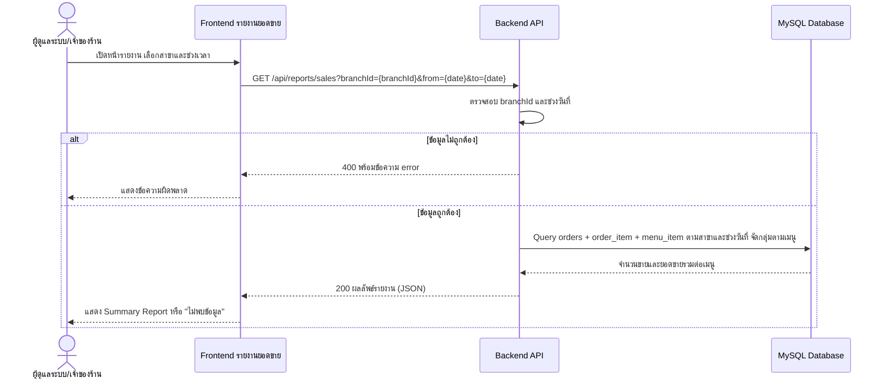

# Week 10: Input/Output Design

> **โครงการ:** Coffee Shop POS System  
> **กลุ่ม:** cafe-pos-group11  
> **เอกสารอ้างอิง:** [wk03-requirements.md](wk03-requirements.md), [wk04-userstories-usecasediagram.md](wk04-userstories-usecasediagram.md), [wk10-wireframe.md](wk10-wireframe.md), [code/schema.sql](../code/schema.sql)

## 1. วัตถุประสงค์

เอกสารนี้อธิบายการออกแบบข้อมูลนำเข้า (Input) และข้อมูลส่งออก (Output) ของระบบร้านกาแฟ โดยเน้นการลดข้อผิดพลาดในการรับออเดอร์ การแสดงใบเสร็จ และรายงานสรุปยอดขาย รวมถึงเชื่อมโยงแบบออกแบบกับ Requirements (FR-01 ถึง FR-08) และ User Stories (US-01 ถึง US-08) ที่กลุ่มจัดทำไว้ก่อนหน้า

## 2. Input Form: หน้ารับออเดอร์ (POS)

### 2.1 ผู้ใช้และวัตถุประสงค์

ผู้ใช้หลักคือพนักงานหน้าร้าน ใช้เลือกสาขา เลือกเมนูและจำนวน ตรวจสอบรายการและยอดรวม เลือกวิธีชำระเงิน และยืนยันออเดอร์ (FR-01, US-01)

### 2.2 ฟิลด์ข้อมูลและการตรวจสอบ

| ฟิลด์ (ชื่อใน API)                  | ชนิด Input                        | ค่าเริ่มต้น/วิธีเลือก                                                   | Validation ที่ต้องมี                                                    | เหตุผล                                    |
| ----------------------------------- | --------------------------------- | ----------------------------------------------------------------------- | ----------------------------------------------------------------------- | ----------------------------------------- |
| สาขา (`branchId`)                   | Dropdown                          | เลือกสาขาที่ใช้งาน; หากเครื่องผูกกับสาขา ให้แสดงสาขานั้นเป็นค่าเริ่มต้น | จำนวนเต็มบวก และต้องมีอยู่จริงในตาราง `branch`                          | ป้องกันออเดอร์และสต็อกผูกกับสาขาผิด       |
| พนักงาน (`employeeId`)              | ค่าจากผู้ใช้ที่เข้าสู่ระบบ        | ใช้พนักงานที่เข้าสู่ระบบ ไม่ให้พิมพ์เอง                                 | จำนวนเต็มบวก และต้องเป็นพนักงานของสาขาที่เลือก                          | ใช้บันทึกผู้รับออเดอร์และแสดงบนใบเสร็จ    |
| เมนู (`items[].menuId`)             | การ์ดเมนูให้กดเลือก หรือ Dropdown | แสดงเฉพาะเมนูของสาขาที่เลือก (`GET /api/menu?branchId=`)                | จำนวนเต็มบวก และต้องเป็นเมนูที่อยู่ในสาขานั้น                           | ป้องกันชื่อเมนูสะกดต่างกันและเมนูข้ามสาขา |
| จำนวน (`items[].quantity`)          | ปุ่มเพิ่ม/ลด หรือ Number input    | เริ่มต้นที่ `1`                                                         | จำนวนเต็มมากกว่า 0 และไม่เกินสต็อกคงเหลือของสาขา                        | ป้องกันจำนวนเป็นศูนย์ ติดลบ หรือทศนิยม    |
| รายการในตะกร้า (`items`)            | ตาราง/รายการ                      | แสดงหลังเพิ่มเมนู                                                       | ต้องมี 1–100 รายการ                                                     | ให้ผู้ใช้ตรวจสอบก่อนยืนยัน                |
| วิธีชำระเงิน (`paymentMethod`)      | Radio                             | ไม่มีค่าเริ่มต้น ผู้ใช้ต้องเลือกเอง                                     | ต้องเป็น `cash`, `qr` หรือ `card` เท่านั้น                              | ป้องกันข้อมูลการชำระเงินไม่ครบ (FR-03)    |
| ยอดรวม                              | ข้อความคำนวณอัตโนมัติ (อ่านอย่างเดียว) | คำนวณจากรายการในตะกร้า                                             | คำนวณจากราคาและจำนวน ไม่รับยอดรวมที่ผู้ใช้พิมพ์เอง                      | ลดความผิดพลาดในการคำนวณ (FR-02)           |

**ข้อกำหนดเรื่องสาขา:** หน้าจอ POS ต้องมีตัวเลือกสาขา และสต็อกที่แสดงต้องเป็นของสาขาที่เลือก (`menu_item.stock_quantity` ผูกกับ `branch_id`) ไม่ใช่ยอดรวมทุกสาขา

**ข้อกำหนดเรื่องราคา:** Frontend ไม่ส่งราคาไปยัง Backend; Backend อ่านราคาจากตาราง `menu_item` ขณะสร้างออเดอร์ แล้วบันทึกเป็น `order_item.unit_price` เพื่อให้ใบเสร็จและรายงานใช้ราคา ณ เวลาขาย แม้ภายหลังจะเปลี่ยนราคาเมนู

### 2.3 Validation และ Error Prevention

1. ปิดปุ่มยืนยันออเดอร์เมื่อไม่มีรายการในตะกร้า
2. จำนวนสินค้าต้องเป็นจำนวนเต็มมากกว่า 0 ทั้งฝั่ง Frontend และ Backend
3. แจ้งเตือนเมื่อไม่ได้เลือกสาขา เมนู หรือวิธีชำระเงิน
4. ปิดปุ่มเพิ่มของเมนูที่สต็อกเป็น 0 และแสดงไอคอนเตือนเมื่อสต็อกต่ำ (เหลือน้อยกว่า 10 แก้ว ตามเกณฑ์ `lowStockMenuIds` ของ Backend) หาก Backend ปฏิเสธเพราะสต็อกไม่พอ ต้องแสดงข้อผิดพลาดและไม่แสดงว่าออเดอร์สำเร็จ
5. คำนวณยอดรวมใหม่ทันทีเมื่อเพิ่ม ลด หรือลบรายการในตะกร้า (US-02 Scenario 2)
6. แสดงสถานะกำลังบันทึก ป้องกันการกดซ้ำระหว่างส่งคำขอ และแสดงผลสำเร็จ/ล้มเหลวหลังได้รับคำตอบจาก Server
7. Backend ตรวจสอบข้อมูลและสต็อกซ้ำเสมอภายใน transaction (ล็อกแถวเมนูด้วย `SELECT ... FOR UPDATE`) เพราะข้อมูลบนหน้าจออาจไม่เป็นปัจจุบัน และผู้ใช้สามารถส่ง Request โดยไม่ผ่าน UI ได้

### 2.4 Feedback ที่ออกแบบไว้

| สถานการณ์                 | Feedback ที่ควรแสดง                                   | พฤติกรรมปุ่มยืนยัน                      |
| ------------------------- | ----------------------------------------------------- | --------------------------------------- |
| ตะกร้าว่าง                | แสดงข้อความว่าไม่มีรายการในตะกร้า และยอดรวม 0 บาท     | ปิดใช้งาน                               |
| ยังไม่ได้เลือกเมนู        | เน้นช่องเลือกเมนูและแสดงข้อความให้เลือก               | ปิดใช้งาน                               |
| จำนวนไม่ถูกต้อง           | แสดงข้อความให้ใส่จำนวนเต็มบวก                         | ปิดใช้งานจนกว่าจะแก้ไข                  |
| ยังไม่เลือกวิธีชำระเงิน   | แสดงข้อความ "กรุณาเลือกวิธีชำระเงิน"                  | ไม่ส่งคำสั่งซื้อ                        |
| สินค้าหมด/สต็อกไม่เพียงพอ | แจ้งเมนูที่สั่งไม่ได้ ("สินค้าหมดชั่วคราว")           | ไม่เพิ่มลงตะกร้า / แสดงข้อผิดพลาดจาก Server (HTTP 400) |
| ข้อมูลถูกแก้ไขพร้อมกัน    | แสดงข้อความจาก Server เช่น "สต็อกเปลี่ยนแปลง กรุณาลองใหม่" หรือ "มีการแก้ไขข้อมูลพร้อมกัน กรุณาลองใหม่" | คงรายการไว้ให้ลองใหม่ (HTTP 409)        |
| กำลังบันทึก               | แสดงสถานะกำลังดำเนินการ                               | ป้องกันการกดซ้ำ                         |
| บันทึกสำเร็จ              | แจ้งผลสำเร็จและแสดงใบเสร็จพร้อมเลขที่ออเดอร์ (`orderId`) | เคลียร์ตะกร้าหลังยืนยันผลสำเร็จเท่านั้น |
| บันทึกสำเร็จแต่สต็อกใกล้หมด | แจ้งเตือนเมนูที่ใกล้หมดจาก `lowStockMenuIds` ใน Response | ไม่กระทบการบันทึกออเดอร์                |
| บันทึกไม่สำเร็จ           | แสดงข้อความผิดพลาดที่เข้าใจได้                        | คงรายการไว้ให้ตรวจสอบ/ลองใหม่ได้        |

### 2.5 Traceability ของ POS

| สิ่งที่ออกแบบ                | Requirement (`wk03`)                              | User Story / Acceptance Criteria (`wk04`)             | หลักฐานตรวจสอบ                                         |
| ---------------------------- | ------------------------------------------------- | ----------------------------------------------------- | ------------------------------------------------------ |
| เลือกเมนูและเพิ่มลงตะกร้า    | FR-01 สร้างรายการสั่งซื้อใหม่                     | US-01 Scenario 1                                      | เลือกเมนูแล้วปรากฏในตะกร้า                             |
| ปิดปุ่มยืนยันเมื่อไม่มีสินค้า | FR-01                                             | US-01 Scenario 2                                      | ตะกร้าว่างแล้วปุ่มยืนยันถูกปิด                         |
| กำหนดจำนวนและคำนวณยอดรวม     | FR-02 คำนวณราคารวมอัตโนมัติ                       | US-02 Scenario 1, 2                                   | เปลี่ยนจำนวนแล้วยอดต่อรายการและยอดรวมเปลี่ยนตรงกัน     |
| เลือกสาขาและตรวจสต็อกตามสาขา | FR-07 ตัดสต็อกอัตโนมัติ (+ ข้อกำหนดสาขาของรายวิชา) | US-07 Scenario 1, 2                                   | เปลี่ยนสาขาแล้วเมนู/สต็อกเปลี่ยน; สั่งเกินสต็อกแล้วถูกปฏิเสธ |
| เลือกวิธีชำระเงินและยืนยัน   | FR-01, FR-03 รับชำระเงิน                          | US-01 Scenario 1, US-03 Scenario 2                    | `POST /api/orders` ตอบ 201 พร้อม `orderId` และบันทึก `payment_method` |

**หมายเหตุ:** FR-07 ระบุการตัดสต็อก "วัตถุดิบตามสูตร" แต่ schema ปัจจุบันเก็บสต็อกเป็นจำนวนแก้วต่อเมนู (`menu_item.stock_quantity`) และยังไม่มีตารางวัตถุดิบ/สูตร การออกแบบนี้จึงตัดสต็อกระดับเมนูก่อน และบันทึกการเปลี่ยนแปลงใน `stock_movement`

## 3. Output: ใบเสร็จ (Receipt)

### 3.1 ผู้ใช้และวัตถุประสงค์

ใบเสร็จเป็น Output สำหรับธุรกรรมเดียว แสดงผลหลังบันทึกออเดอร์สำเร็จ เพื่อให้พนักงานและลูกค้าตรวจสอบรายการและยอดชำระ (FR-04, US-04) ข้อมูลใบเสร็จดึงจาก `GET /api/orders/:order_id?branchId={branchId}`

### 3.2 ฟิลด์ที่ออกแบบ

| ข้อมูล        | แหล่งข้อมูล                                | รายละเอียด                                       |
| ------------- | ------------------------------------------ | ------------------------------------------------ |
| ชื่อร้าน      | ค่าคงที่ของระบบ                            | ชื่อร้านกาแฟตามที่กลุ่มกำหนด                     |
| เลขที่ออเดอร์ | `orders.order_id`                          | รหัสออเดอร์ที่ระบบสร้าง (FR-04)                  |
| สาขา          | `orders.branch_id` → `branch.name`         | สาขาที่รับออเดอร์                                |
| พนักงาน       | `orders.employee_id` → `employee.name`     | พนักงานผู้รับออเดอร์                             |
| วันและเวลา    | `orders.created_at`                        | เวลาที่บันทึกธุรกรรม (FR-04)                     |
| รายการสินค้า  | `order_item.menu_id` → `menu_item.name`    | ชื่อเมนูแต่ละรายการ                              |
| จำนวน         | `order_item.quantity`                      | จำนวนของแต่ละเมนู                                |
| ราคาต่อหน่วย  | `order_item.unit_price`                    | ราคา ณ เวลาขาย ไม่ใช่ราคาปัจจุบันของเมนู         |
| ยอดต่อรายการ  | `subtotal` = `quantity × unit_price`       | คำนวณโดย Backend                                 |
| ยอดรวมสุทธิ   | `total`                                    | ผลรวมของทุกรายการ แสดงให้เด่นชัด                 |
| วิธีชำระเงิน  | `orders.payment_method`                    | แสดงเป็น เงินสด / QR Code / บัตร ตามค่า `cash`/`qr`/`card` |

### 3.3 หลักการจัดรูปแบบ

- วางยอดรวมสุทธิในตำแหน่งที่สังเกตเห็นง่าย
- จัดรายการสินค้า จำนวน และราคาให้อ่านเทียบกันได้ง่าย
- ใช้รูปแบบสม่ำเสมอในทุกใบเสร็จ
- ไม่แสดงข้อมูลที่ไม่จำเป็นต่อการตรวจสอบธุรกรรม
- ใบเสร็จต้องสร้างจากข้อมูลออเดอร์ที่ Backend บันทึกสำเร็จแล้ว ไม่สร้างจากข้อมูลในตะกร้าที่ยังไม่ได้รับการยืนยัน

### 3.4 Traceability ของใบเสร็จ

| สิ่งที่ออกแบบ                          | Requirement / User Story                              |
| -------------------------------------- | ----------------------------------------------------- |
| แสดงรายการ ราคา และยอดรวมของออเดอร์    | FR-02, FR-04 / US-02 Scenario 1, US-04 Scenario 1     |
| แสดงเลขที่ออเดอร์ วันที่ และเวลา       | FR-04 / US-04 Scenario 1                              |
| แสดงสาขาและพนักงาน                     | ข้อกำหนดสาขาของรายวิชา (ข้อมูลเพิ่มเติมจาก FR-04)     |
| แสดงวิธีชำระเงิน                       | FR-03 / US-03 Scenario 2                              |
| สั่งพิมพ์ใบเสร็จ                       | FR-04 / US-04 Scenario 2                              |

## 4. Output: รายงานยอดขาย (Summary Report)

### 4.1 ผู้ใช้และวัตถุประสงค์

รายงานยอดขายมีไว้ให้ผู้ดูแลระบบ/เจ้าของร้านตรวจสอบผลการขายจากหลายธุรกรรม (FR-08, US-08) รูปแบบที่ออกแบบคือ Summary Report สรุปยอดขายตามเมนู ของสาขาและช่วงเวลาที่เลือก

### 4.2 คอลัมน์รายงาน

| คอลัมน์          | ความหมาย                                                                           |
| ---------------- | ---------------------------------------------------------------------------------- |
| เมนู             | ชื่อเมนูที่ขายได้                                                                  |
| จำนวนที่ขายได้   | `SUM(order_item.quantity)` ของเมนูนั้นในสาขาและช่วงเวลาที่เลือก                    |
| ยอดขายรวม        | `SUM(order_item.quantity × order_item.unit_price)` ใช้ราคา ณ เวลาขาย               |
| ยอดขายรวมทั้งหมด | ผลรวมยอดขายของทุกเมนูในรายงาน                                                      |

**หมายเหตุ:** ไม่แสดงคอลัมน์ "ราคาต่อหน่วย" เป็นค่าเดียวในรายงาน เพราะเมนูเดียวกันอาจขายในราคาต่างกันหากมีการเปลี่ยนราคาระหว่างช่วงเวลา; ยอดขายรวมคำนวณจาก `unit_price` ของแต่ละรายการจริง

### 4.3 ตัวกรองและข้อกำหนด

- ต้องมีตัวเลือกสาขา และรายงานต้องแยกข้อมูลตามสาขา ไม่รวมยอดข้ามสาขาโดยไม่ตั้งใจ
- ต้องมีตัวเลือกช่วงเวลา รายวัน รายเดือน รายปี ตาม FR-08 (ส่งเป็นช่วงวันที่ `from`/`to` ไปยัง API)
- ต้องสร้างรายงานภายใน 5 วินาที และยอดต้องตรงกับรายการขายที่บันทึกไว้ (US-08 Scenario 1, 2)
- ต้องมีสถานะกำลังโหลด ไม่พบข้อมูล และเกิดข้อผิดพลาด
- ข้อมูลตัวอย่างใน Wireframe เป็นข้อมูลจำลอง ไม่ใช่ผล Query จากฐานข้อมูลจริง
- การเปรียบเทียบยอดกับวันก่อนหน้า หรือระหว่างสาขา เป็นงานขยายผลที่ไม่อยู่ใน FR-08
- เมนูขายดีและยอดขายรายพนักงาน (คำตอบสัมภาษณ์ข้อ 8 ใน wk03) ยังไม่อยู่ในขอบเขตของรายงานนี้

### 4.4 Traceability ของรายงาน

| สิ่งที่ออกแบบ                     | Requirement / User Story                    |
| --------------------------------- | ------------------------------------------- |
| ดูยอดขายสรุปตามเมนู               | FR-08 / US-08                               |
| เลือกช่วงเวลา รายวัน/เดือน/ปี     | FR-08 / US-08 Scenario 1                    |
| กรองรายงานตามสาขา                 | ข้อกำหนดสาขาของรายวิชา (ขยายจาก FR-08)      |
| แสดงจำนวนขายและยอดขายรวมที่ถูกต้อง | FR-08 / US-08 Scenario 2                    |

## 5. Draft Sequence Diagram: ดึงรายงานยอดขาย

Sequence Diagram นี้เป็นแบบร่างสำหรับ endpoint ที่จะพัฒนาในสัปดาห์ที่ 13



**สถานะ:** `GET /api/reports/sales` **ยังไม่ได้ implement** ปัจจุบัน Backend มีเฉพาะ `/api/menu` และ `/api/orders`

### 5.1 รูปแบบข้อมูลตอบกลับที่เสนอ

```json
{
  "branchId": 1,
  "from": "2026-10-01",
  "to": "2026-10-31",
  "items": [
    {
      "menuId": 1,
      "name": "Latte",
      "totalQuantity": 2,
      "totalSales": 90
    }
  ],
  "grandTotal": 90
}
```

ตัวเลขข้างต้นเป็นข้อมูลตัวอย่างเท่านั้น เนื่องจาก `unit_price` เป็น `DECIMAL(10,2)` ไลบรารี `mysql2` จะส่งผลรวมกลับเป็น string โดยค่าเริ่มต้น Backend ควรแปลงเป็นตัวเลขก่อนส่ง (แบบเดียวกับการคำนวณ `total` ใน `orderModel.findById`)

## 6. สถานะการ Implement และข้อจำกัด

| รายการ                                                 | สถานะ                                                                 |
| ------------------------------------------------------ | --------------------------------------------------------------------- |
| Validation ฝั่ง Backend ของ `POST /api/orders`          | Implement แล้ว (`branchId`, `employeeId`, `items`, `paymentMethod`, สต็อก) |
| ตัดสต็อกและคืนสต็อกเมื่อยกเลิกออเดอร์                   | Implement แล้ว (transaction + `stock_movement`)                        |
| ข้อมูลใบเสร็จจาก `GET /api/orders/:order_id`            | Implement แล้ว (ส่ง `items`, `subtotal`, `total`; ยังไม่ join ชื่อสาขา/พนักงาน) |
| หน้า POS ฝั่ง Frontend (`code/web`)                    | เป็นต้นแบบที่เก็บข้อมูลใน `localStorage` ยังไม่เรียก API จริง; รองรับเฉพาะ `cash` และ `qr`; เตือนสต็อกต่ำที่ ≤ 8 แก้ว (ต่างจาก Backend ที่ < 10); ชื่อสาขาและพนักงานบนใบเสร็จยังเป็นค่าคงที่ |
| สถานะ "ชำระเงินแล้ว" ตาม FR-03                          | ยังไม่มีคอลัมน์สถานะในตาราง `orders`; ปัจจุบันถือว่าออเดอร์ที่บันทึกแล้วชำระเงินแล้ว |
| รายงานยอดขาย `GET /api/reports/sales`                  | ยังไม่ implement (แผนสัปดาห์ที่ 13)                                    |
| การส่งออเดอร์ไปหน้าจอบาริสต้า (FR-05)                  | อยู่นอกขอบเขตของเอกสาร Input/Output นี้                               |
