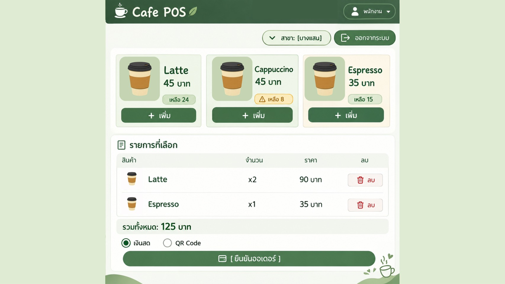
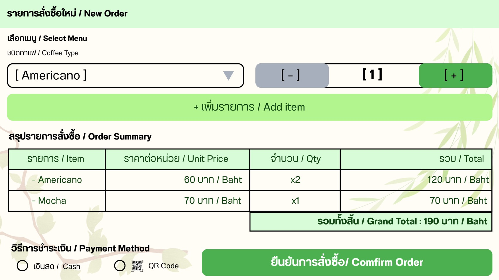
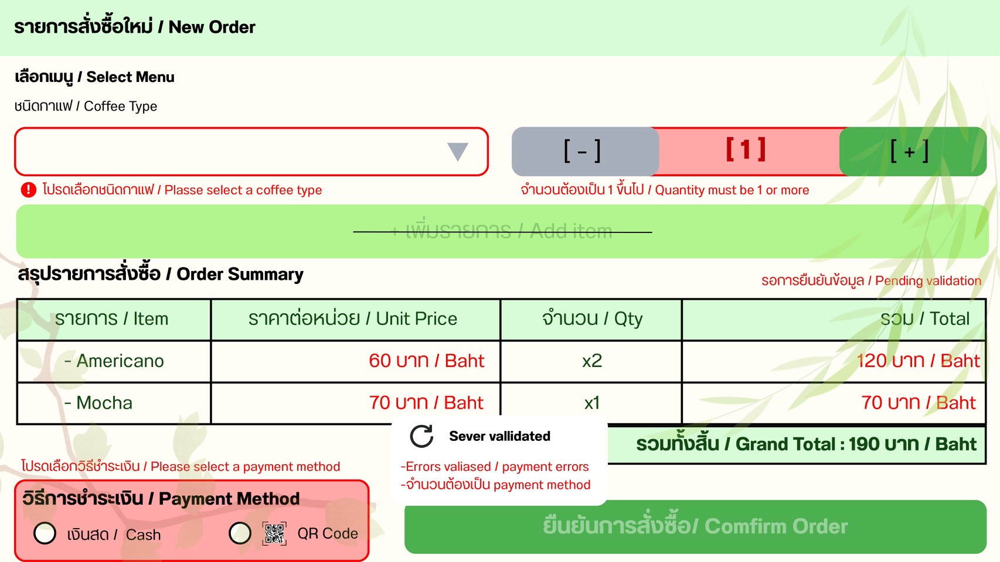
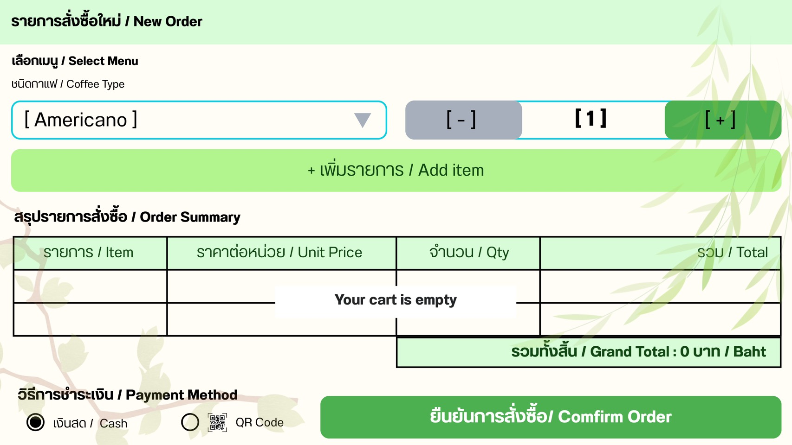
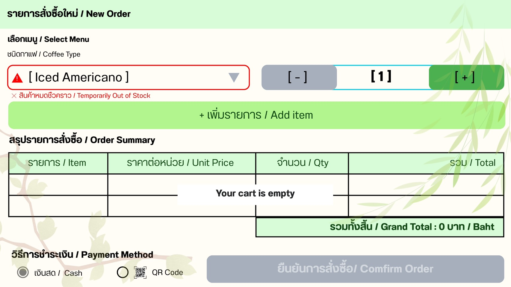
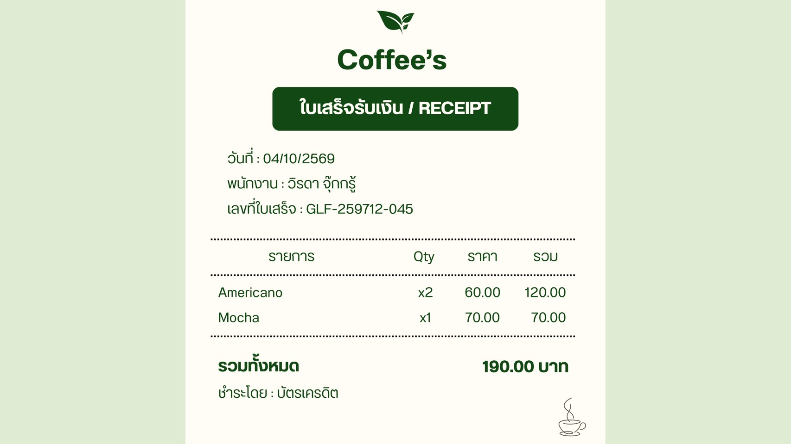
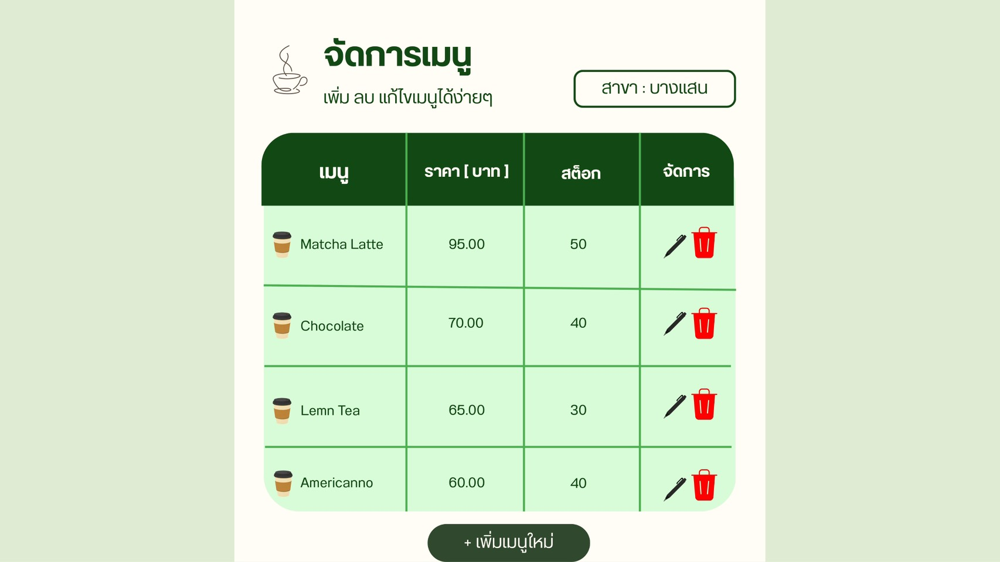
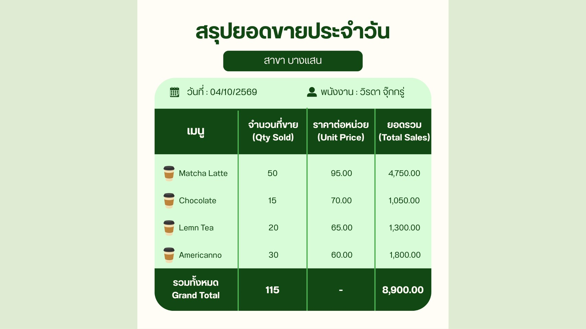
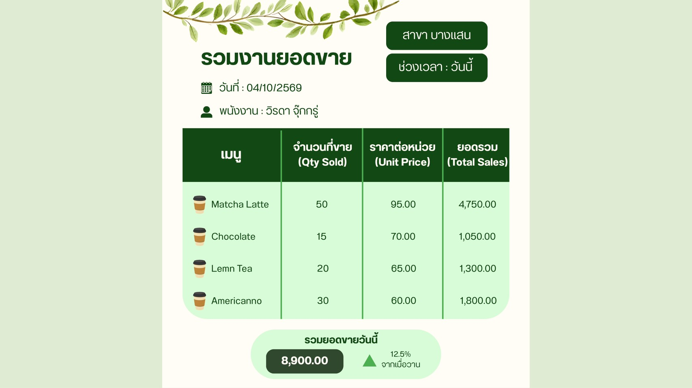

# Week 10: Wireframe

**โครงการ:** Coffee Shop POS System  
**กลุ่ม:** cafe-pos-group11  
**ระดับ Wireframe:** Mid-Fi  
**หน้าจอที่ออกแบบ:** หน้ารับออเดอร์ (POS), หน้าจัดการเมนู, หน้ารายงานยอดขาย และใบเสร็จ

---

## 1. หน้ารับออเดอร์ POS

### 1.1 Wireframe หลัก

ภาพหลักของหน้ารับออเดอร์ แสดงตัวเลือกสาขาที่มุมขวาบน การ์ดเมนูพร้อมราคาและจำนวนคงเหลือ (สต็อกต่ำแสดงไอคอนเตือน) รายการที่เลือกพร้อมปุ่มลบ ยอดรวม วิธีชำระเงิน และปุ่มยืนยันออเดอร์

รูปแบบทางเลือกที่ใช้ dropdown เลือกเมนูพร้อมปุ่มเพิ่ม/ลดจำนวน และตารางสรุปรายการสั่งซื้อที่แสดงราคาต่อหน่วย จำนวน ยอดต่อรายการ และยอดรวมทั้งสิ้น ภาพในหัวข้อ 1.2 ใช้ layout นี้เพื่อแสดงสถานะต่าง ๆ

### 1.2 สถานะและการป้องกันข้อผิดพลาด

**สถานะ Validation:** เมื่อยังไม่เลือกชนิดกาแฟ จำนวนไม่ถูกต้อง หรือยังไม่เลือกวิธีชำระเงิน ระบบไฮไลต์ช่องที่ผิดด้วยกรอบสีแดง แสดงข้อความแจ้งเตือนใต้ช่องนั้น และปิดปุ่มเพิ่มรายการและปุ่มยืนยันออเดอร์ หากเซิร์ฟเวอร์ปฏิเสธข้อมูล ระบบแสดงกล่องข้อความผลการตรวจสอบจากเซิร์ฟเวอร์

**สถานะตะกร้าว่าง:** แสดงข้อความ "Your cart is empty" และยอดรวม 0 บาท ปุ่มยืนยันออเดอร์ต้องถูกปิด (สีเทา) เพื่อป้องกันการส่งออเดอร์ว่าง

**สถานะสินค้าหมด:** เมื่อเลือกเมนูที่สต็อกของสาขาเป็น 0 ระบบแสดงไอคอนเตือนและข้อความ "สินค้าหมดชั่วคราว / Temporarily Out of Stock" ใต้ช่องเลือกเมนู รายการนั้นไม่ถูกเพิ่มลงตะกร้า และปุ่มยืนยันออเดอร์ยังคงถูกปิด

### 1.3 ใบเสร็จหลังยืนยันออเดอร์

ใบเสร็จที่แสดงหลังบันทึกออเดอร์สำเร็จ ประกอบด้วยวันที่ ชื่อพนักงาน เลขที่ใบเสร็จ รายการสินค้า จำนวน ราคาต่อหน่วย ยอดต่อรายการ ยอดรวม และวิธีชำระเงิน (Backend รองรับ `cash`, `qr` และ `card`)

### 1.4 องค์ประกอบหลัก

- ตัวเลือกสาขา
- รายการเมนูของสาขาที่เลือก พร้อมราคาและจำนวนคงเหลือ
- ปุ่มเพิ่ม/ลดจำนวน และปุ่มลบรายการ
- ตารางรายการที่เลือก แสดงชื่อเมนู ราคาต่อหน่วย จำนวน และยอดต่อรายการ
- ยอดรวมทั้งสิ้น
- วิธีชำระเงิน
- ปุ่มยืนยันออเดอร์
- ข้อความแจ้งเตือน validation, สถานะสินค้าหมด และผลการบันทึกสำเร็จหรือล้มเหลว

### 1.5 Traceability

- **Requirement:** FR-01 สร้างรายการสั่งซื้อใหม่, FR-02 คำนวณราคารวมอัตโนมัติ, FR-03 รองรับการรับชำระเงิน, FR-04 พิมพ์ใบเสร็จ, FR-07 ตัดสต็อกอัตโนมัติ
- **User Story:** US-01 สร้างรายการสั่งซื้อ, US-02 คำนวณราคารวม, US-03 รับชำระเงิน, US-04 พิมพ์ใบเสร็จ, US-07 ตัดสต็อกวัตถุดิบ
- **Acceptance Criteria:**
  1. เมื่อเลือกเมนูและกดเพิ่ม ระบบต้องแสดงรายการนั้นในตะกร้า (US-01)
  2. เมื่อเพิ่ม ลด หรือลบสินค้า ระบบต้องคำนวณยอดรวมใหม่ทันทีและตรงกับผลรวมของทุกรายการ (US-02)
  3. เมื่อตะกร้าว่าง ระบบต้องแสดงสถานะตะกร้าว่างและปิดปุ่มยืนยันออเดอร์ (US-01 Scenario 2)
  4. เมื่อยังไม่เลือกเมนู จำนวนน้อยกว่า 1 หรือยังไม่เลือกวิธีชำระเงิน ระบบต้องแสดงข้อความแจ้งเตือนใกล้ช่องที่ผิด
  5. เมื่อสต็อกของสาขาที่เลือกไม่พอ ระบบต้องแจ้งสินค้าหมดและไม่เพิ่มรายการลงตะกร้า และ Backend ต้องปฏิเสธออเดอร์ที่สต็อกไม่พอ (US-07)
  6. เมื่อบันทึกออเดอร์สำเร็จ ระบบต้องแจ้งผลและแสดงใบเสร็จ (US-03, US-04)
- **Endpoint ที่เกี่ยวข้อง:**
  - `POST /api/orders` — สร้างออเดอร์ (body: `branchId`, `employeeId`, `items`, `paymentMethod`)
  - `GET /api/orders/:order_id?branchId={branchId}` — ดูออเดอร์ตาม ID และสาขา (ใช้แสดงใบเสร็จ)
  - `GET /api/orders/branch/:branch_id` — ดูรายการออเดอร์ทั้งหมดของสาขา
  - `DELETE /api/orders/:order_id?branchId={branchId}` — ยกเลิกออเดอร์และคืนสต็อก
  - `GET /api/menu?branchId={branchId}` — โหลดเมนูของสาขาที่เลือกมาแสดงบนหน้า POS

---

## 2. หน้าจัดการเมนู

หน้าจอแสดงสาขาปัจจุบัน ตารางเมนูพร้อมราคาและสต็อกของสาขานั้น ปุ่มแก้ไข (ไอคอนดินสอ) และลบ (ไอคอนถังขยะ) ในแต่ละแถว และปุ่ม "เพิ่มเมนูใหม่" ด้านล่าง

### 2.1 องค์ประกอบหลัก

- ตัวเลือกสาขา
- ตารางแสดงชื่อเมนู ราคา และสต็อกของสาขาที่เลือก
- ปุ่มเพิ่มเมนูใหม่
- ปุ่มแก้ไขและลบในแต่ละแถว
- ฟอร์มเพิ่ม/แก้ไขเมนู (สาขา หมวดหมู่ ชื่อเมนู ราคา จำนวนสต็อก)
- Validation: ชื่อเมนูห้ามว่าง ราคาต้องมากกว่า 0 สต็อกต้องไม่ติดลบ และชื่อเมนูห้ามซ้ำในสาขาเดียวกัน (ตาม `UNIQUE (branch_id, name)` ใน schema)
- กล่องยืนยันก่อนลบ และข้อความแจ้งผลเมื่อบันทึกสำเร็จหรือล้มเหลว

### 2.2 Traceability

- **Requirement:** FR-06 ระบบต้องสามารถเพิ่ม แก้ไข และลบเมนูได้
- **User Story:** US-06 จัดการเมนู
- **Acceptance Criteria:**
  1. ระบบต้องแสดงเฉพาะเมนูของสาขาที่เลือก
  2. เมื่อเพิ่มหรือแก้ไขเมนูด้วยข้อมูลที่ถูกต้อง ระบบต้องบันทึกและแสดงข้อมูลล่าสุดภายใน 3 วินาที (US-06 Scenario 1)
  3. เมื่อข้อมูลไม่ถูกต้อง เช่น ชื่อว่าง ราคาไม่ถูกต้อง หรือชื่อซ้ำในสาขา ระบบต้องแสดงข้อความแจ้งเตือนและไม่บันทึก
  4. เมื่อลบเมนู เมนูนั้นต้องไม่ปรากฏในรายการอีก (US-06 Scenario 2)
  5. ระบบต้องแก้ไขหรือลบได้เฉพาะเมนูที่อยู่ในสาขาที่ระบุ
- **Endpoint ที่เกี่ยวข้อง:**
  - `GET /api/menu?branchId={branchId}` — แสดงรายการเมนูของสาขา
  - `GET /api/menu/:id?branchId={branchId}` — ดูรายละเอียดเมนู
  - `POST /api/menu` — เพิ่มเมนู
  - `PUT /api/menu/:id` — แก้ไขเมนู (ระบุ `branchId` ใน body)
  - `DELETE /api/menu/:id?branchId={branchId}` — ลบเมนู

---

## 3. หน้ารายงานยอดขาย

รายงานสรุปยอดขายประจำวันของสาขา แสดงวันที่ ชื่อพนักงาน และตารางยอดขายแยกตามเมนู (จำนวนที่ขาย ราคาต่อหน่วย ยอดรวม) พร้อมแถวรวมทั้งหมด

รูปแบบทางเลือกที่เพิ่มตัวเลือกสาขาและช่วงเวลา และเน้นยอดขายรวมของช่วงเวลานั้นด้านล่าง ตัวเลขเปรียบเทียบกับเมื่อวานเป็นแนวคิดเพิ่มเติมที่ยังไม่อยู่ใน FR-08

### 3.1 องค์ประกอบหลัก

- ตัวเลือกสาขา
- ตัวเลือกช่วงเวลา (รายวัน รายเดือน รายปี ตาม FR-08)
- ตารางสรุปยอดขายตามเมนู: จำนวนที่ขาย ราคาต่อหน่วย ยอดรวมต่อเมนู
- ยอดขายรวมทั้งหมด
- สถานะกำลังโหลด ไม่พบข้อมูล และเกิดข้อผิดพลาด

### 3.2 Traceability

- **Requirement:** FR-08 ระบบต้องสามารถสร้างรายงานยอดขายได้
- **User Story:** US-08 ดูรายงานยอดขาย
- **Acceptance Criteria:**
  1. ผู้ใช้เลือกสาขาและช่วงเวลา (รายวัน/รายเดือน/รายปี) ได้
  2. ระบบต้องสร้างรายงานภายใน 5 วินาที (US-08 Scenario 1)
  3. ยอดขายในรายงานต้องตรงกับรายการขายที่บันทึกไว้ทั้งหมด (US-08 Scenario 2)
  4. เมื่อไม่มีข้อมูลในช่วงเวลาที่เลือก ระบบต้องแสดงสถานะ "ไม่พบข้อมูล"
  5. เมื่อโหลดรายงานไม่สำเร็จ ระบบต้องแจ้งข้อผิดพลาด
- **Endpoint ที่เกี่ยวข้อง:**
  - `GET /api/reports/sales?branchId={branchId}&from={date}&to={date}` — **ยังไม่ได้ implement** ปัจจุบัน Backend มีเฉพาะ `/api/menu` และ `/api/orders` โดยมีแผน implement ในสัปดาห์ที่ 13

---

## 4. หลักการ UI/UX ที่ใช้

- **Consistency:** ตัวเลือกสาขาอยู่ตำแหน่งเดียวกันทุกหน้า และใช้โทนสีเขียวกับรูปแบบตารางเดียวกัน
- **Feedback:** แสดงผลทันทีเมื่อเพิ่มสินค้า บันทึกออเดอร์ บันทึกเมนู หรือโหลดรายงาน ทั้งกรณีสำเร็จและล้มเหลว
- **Error Prevention:** ปิดปุ่มยืนยันเมื่อตะกร้าว่างหรือข้อมูลไม่ครบ ไม่ให้เพิ่มสินค้าที่หมด และยืนยันก่อนลบเมนู
- **Visibility:** แสดงยอดรวม จำนวนในตะกร้า และสต็อกคงเหลือตลอดเวลา พร้อมเตือนเมื่อสต็อกต่ำ
- **Error Recovery:** ข้อความแจ้งเตือนอยู่ใกล้ช่องที่ผิดและบอกวิธีแก้
- **Minimalist Design:** แต่ละหน้าจอแสดงเฉพาะข้อมูลที่จำเป็นกับงานนั้น

---

## 5. Design Review

- ผู้ทบทวน: สมาชิกในกลุ่ม
- ข้อเสนอแนะ: ควรทำให้ปุ่มยืนยันออเดอร์มองเห็นได้ชัดเจน แสดงยอดรวมให้เด่น และแจ้งเตือนเมื่อสินค้าในสาขาหมด เพื่อช่วยลดความผิดพลาดระหว่างรับออเดอร์
- การแก้ไขหลังรีวิว: ปรับตำแหน่งและความชัดเจนของปุ่มยืนยันออเดอร์ แสดงยอดรวมในตำแหน่งที่สังเกตง่าย และเพิ่มสถานะเตือนเมื่อสินค้าไม่มีสต็อก

---

## 6. UI Implementation และ Commit

- **Frontend path:** `code/web/` (`index.html`, `script.js`, `style.css`) มี 3 หน้าในไฟล์เดียว: รายการสั่งซื้อ จัดการเมนู และรายงานยอดขาย
- **Git commit:** `4dbf45c`
- **Demo URL:** ไม่มี
- **สถานะการเชื่อมต่อ API:** ยังไม่เชื่อมต่อ API ทุก endpoint ขณะนี้ Frontend ใช้ข้อมูลเมนูตัวอย่าง (`initialMenus`) ใน `script.js` และยังไม่มีการเรียก `fetch` ไปยัง `/api/menu` หรือ `/api/orders`
- **ความแตกต่างระหว่าง Wireframe กับ UI จริง:**
  - สาขาใน UI จริงแสดงเป็นข้อความคงที่ "บางแสน" ยังไม่ใช่ตัวเลือกสาขาตาม wireframe
  - UI จริงใช้ sidebar นำทางระหว่าง 3 หน้า ส่วน wireframe ออกแบบแยกเป็นหน้าจอเดี่ยว
  - หน้ารายงานใน UI จริงคำนวณจากข้อมูลตัวอย่าง เพราะ `GET /api/reports/sales` ยังไม่ถูก implement

---

## 7. สรุป

เอกสารนี้นำเสนอ Mid-Fi Wireframe ของระบบ Coffee Shop POS สำหรับหน้ารับออเดอร์ (รวมสถานะ validation, ตะกร้าว่าง, สินค้าหมด และใบเสร็จ), หน้าจัดการเมนู และหน้ารายงานยอดขาย แต่ละหน้าเชื่อมโยงกับ FR (wk03), User Story (wk04) และ endpoint จริงของ Backend ส่วนรายงานยอดขายรอ implement ในสัปดาห์ที่ 13 และ Frontend ยังต้องเชื่อมต่อ API แทนข้อมูลตัวอย่าง
