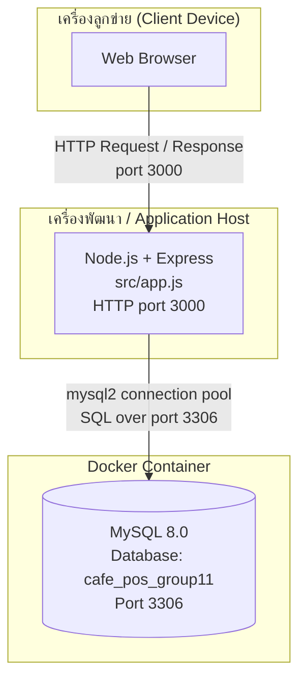
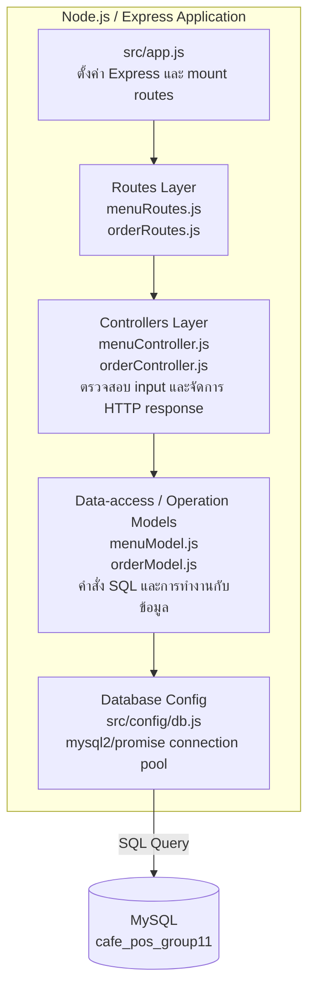

# WK11: Architecture Diagram — Cafe POS Group 11

> เอกสารนี้จัดทำจากโครงสร้าง repository ที่มีอยู่จริงในไฟล์ `cafe-pos-group11` ณ วันที่จัดทำ ไม่ได้เพิ่ม component ที่ยังไม่มีในโค้ด

## 1. Physical View

แสดงการเชื่อมต่อระหว่างเครื่องลูกข่าย, Node.js/Express application และ MySQL ตามการตั้งค่าใน `docker-compose.yml` โดย MySQL ทำงานใน Docker container และเปิดพอร์ต `3306` ให้เครื่องที่รันแอปพลิเคชันเชื่อมต่อ

**หมายเหตุ:** Diagram นี้สะท้อนการตั้งค่าที่พบใน repository: `src/app.js` ใช้พอร์ต `3000` เป็นค่าเริ่มต้น และ `docker-compose.yml` กำหนด MySQL container พร้อม mapping `3306:3306` ทั้งนี้ค่าการเชื่อมต่อจริงของแอปขึ้นกับตัวแปรใน `.env` ซึ่งไม่ได้เปิดเผยไว้ในเอกสารนี้

## 2. Development View

โครงสร้างจริงมี Routes, Controllers, Data-access Models และ Config สำหรับเชื่อมต่อฐานข้อมูล โดย `menuModel.js` และ `orderModel.js` เรียกใช้ `src/config/db.js` เพื่อทำคำสั่ง SQL ผ่าน MySQL connection pool

### หน้าที่ของแต่ละส่วน

- **`src/app.js`** — สร้าง Express application, เปิด JSON middleware, mount `/api/menu` และ `/api/orders` และกำหนด error handler
- **`src/routes/menuRoutes.js` และ `src/routes/orderRoutes.js`** — กำหนด HTTP method และ endpoint แล้วส่งต่อไปยัง controller
- **`src/controllers/menuController.js` และ `src/controllers/orderController.js`** — ตรวจสอบข้อมูล request และสร้าง HTTP response
- **`src/models/menuModel.js` และ `src/models/orderModel.js`** — ติดต่อฐานข้อมูลและดำเนินการ query; `orderModel.js` มีการใช้ transaction สำหรับการสร้างและยกเลิกออเดอร์
- **`src/config/db.js`** — สร้างและ export MySQL connection pool ด้วย `mysql2/promise`

### ข้อสังเกตจากการเทียบกับ repository จริง

1. ใน repository ที่ส่งมาตรวจ **ไม่พบไฟล์ `src/models/Order.js` ที่มี Domain Class `Order`/`OrderItem`** ตามข้อกำหนดที่เอกสาร WK11 อ้างถึงจากสัปดาห์ 6 ดังนั้น Development View ข้างต้นจึงแสดงเฉพาะไฟล์ที่มีอยู่จริง ไม่ได้วาด `Order.js` เสมือนว่ามีแล้ว ควรตรวจสอบและเพิ่มไฟล์ดังกล่าวหากเป็นข้อบังคับของรายวิชา
2. พบ `src/models/orderModel.js` และ `src/models/menuModel.js` จริง จึงแสดง Data-access / Operation Models ใน diagram
3. `docker-compose.yml` ระบุชื่อฐานข้อมูล `cafe_pos_group11` ไม่ใช่ `cafe_pos` จึงใช้ชื่อที่ตรงกับ repository นี้
4. ควรตรวจสอบการเชื่อมต่อระหว่าง routes กับ controller ก่อนส่งงาน: `orderController.js` ใน repository ที่ตรวจพบ export เพียง `createOrder` แต่ `orderRoutes.js` อ้างถึง `getOrderById`, `getOrdersByBranch` และ `deleteOrder` ด้วย ส่วน `menuRoutes.js` อ้างถึง `deleteMenu` ซึ่งมี export อยู่ใน `menuController.js` อย่างไรก็ตาม ควรทดสอบ endpoint จริงอีกครั้งเพื่อยืนยันการทำงาน

## 3. สรุปสถาปัตยกรรม

ระบบ Cafe POS Group 11 ใช้แนวทาง **Monolithic Architecture ร่วมกับ Layered Architecture** ในระดับโครงสร้างโค้ด เพราะแอปพลิเคชัน Node.js/Express อยู่ใน repository เดียวและมี entry point ที่ `src/app.js` โดยแบ่งความรับผิดชอบเป็น routes, controllers, models และ config ขณะที่ฐานข้อมูล MySQL ทำงานผ่าน Docker container แยกจาก process ของแอปพลิเคชัน การจัดโครงสร้างแบบนี้เหมาะกับโครงงานขนาดเล็ก เพราะพัฒนาและดูแลได้ไม่ซับซ้อนเท่า Microservices และยังแยกหน้าที่ของแต่ละชั้นได้ชัดเจน ระบบใช้ `branch_id` ในฐานข้อมูลเพื่อแยกข้อมูลแต่ละสาขา โดยไม่ได้แสดงว่ามีฐานข้อมูลหรือ service แยกตามสาขา ทั้งนี้ Development View สะท้อนเฉพาะไฟล์ที่พบจริง และควรแก้ไขข้อสังเกตเรื่อง Domain Class `Order.js` และการอ้างถึง controller methods ให้เรียบร้อยก่อนส่งงาน
